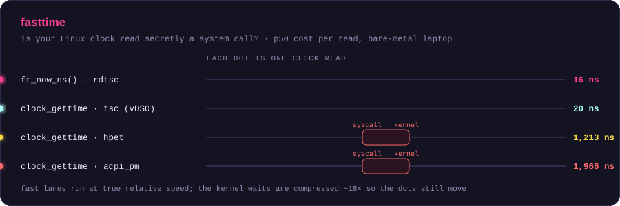

  

- 🛠️ Wrote a **compiler for a C-like language** that runs end to end: Flex/Bison front end, Three Address Code with an optimizer (`-O1` to `-O3`), and register-allocated MIPS that runs on SPIM.
- ⚡ Measuring things at the nanosecond level: **fastparse** (SIMD parsers for market data) and **fasttime** (why your `clock_gettime` might secretly be a system call).
- ⚛️ Quantum computing: QAOA for peptide design (Qiskit Fall Fest 2026), a quantum–classical crossover study for α-RuCl₃, and contributions to **Quantum++**.
- 🧮 Merged fix in **Eigen**, the C++ linear algebra library, on GitLab.

---

## ⚙️ How my projects work

Every animation is hand-written SVG; the numbers come from each repo's own measurements. Click one to open the project.

---

## 📊 Activity

  

  

  

  <picture>
    <source media="(prefers-color-scheme: dark)" srcset="https://raw.githubusercontent.com/migikun474/migikun474/output/snake-dark.svg"/>
    
  </picture>

---

## 🌐 Open source

- [**Eigen**](https://gitlab.com/libeigen/eigen) (C++ linear algebra library, on GitLab): [!3412 — merged](https://gitlab.com/libeigen/eigen/-/merge_requests/3412). Building an `Affine` or `Isometry` transform from a full matrix now resets the last row to `[0 … 0 1]`, so the transform can no longer silently break its own mode.
- [**Quantum++**](https://github.com/migikun474/qpp) (C++17 quantum computing library by softwareQ): added `qpp::fidelity()`, `qpp::trace_distance()`, `qpp::purity()` and arbitrary state preparation with `qpp::state_prep_circuit()`.

  
  

More projects

- [T20 World Cup Simulator](https://github.com/migikun474/multithreaded-t20-worldcup-simulator) — a cricket match where every player is a POSIX thread, with FCFS/SJF/priority scheduling and Banker's Algorithm deadlock detection.
- [OptiTrace](https://github.com/migikun474/OptiTrace) — compiler plugin and runtime for finding hot code paths and comparing Clang and GCC optimization passes.
- [Yield Curve Prediction (CIR)](https://github.com/migikun474/-Yield-Curve-Prediction-using-CIR-method) — predicts the 6M–30Y yield curve from the 3-month rate; the jump-diffusion CIR model reaches R² = 0.94 out of sample.
- [VITERBI](https://github.com/migikun474/VITERBI) — Viterbi decoding of a hidden Markov model for exon / splice site / intron structure in DNA.
- [PCA_GENE_EXPRESSION](https://github.com/migikun474/PCA_GENE_EXPRESSION) — PCA from scratch in NumPy, separating ER+ and ER− breast-cancer samples.
- [GO-ENRICHMENT](https://github.com/migikun474/GO-ENRICHMENT) — strand-aware promoter regions upstream of human TSSs with bedtools.
- [Gene2Protein](https://github.com/migikun474/Gene2Protein) — CYP2E1 transcripts, proteins and protein-to-genome mapping in R.

---

## 🛠️ Skills

  
  
  
  
  
  
  

  
  
  
  
  
  
  

  
  
  
  
  
  

  
  
  
  
  

---

---

## 📫 Contact

💡 Open to collaborating on systems, compilers, low-latency and quantum-computing projects.

<!-- Fill in and uncomment to show contact links:

  
  

-->
